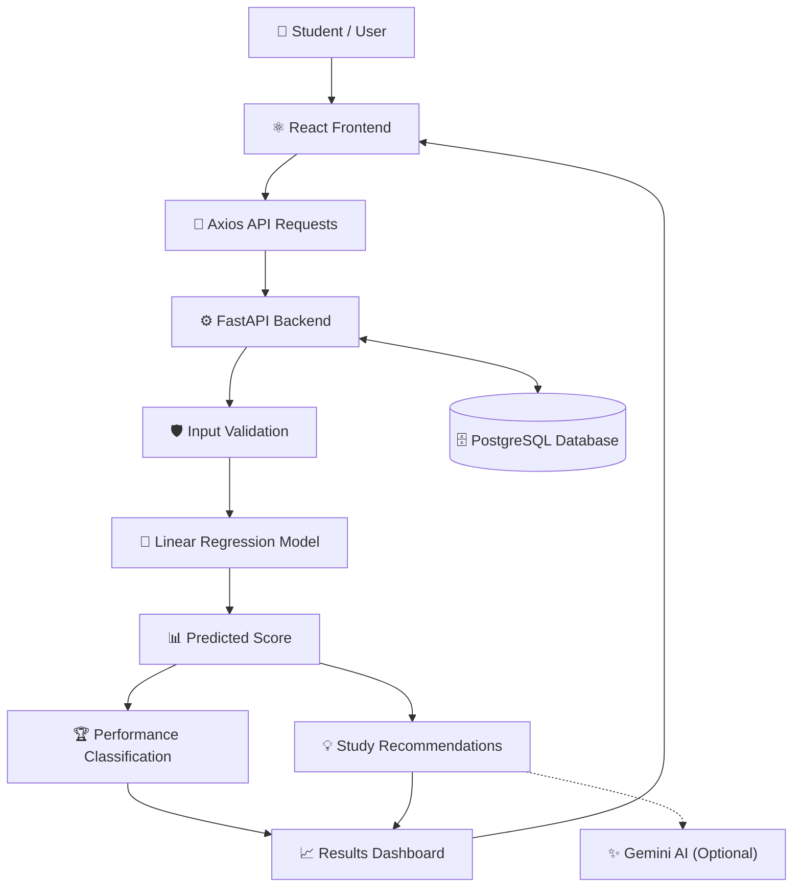

<div align="center">

# 🎓 EduPredict AI
### Student Performance Prediction System

**Predict Performance. Discover Potential. Improve Learning.**

A machine learning-powered web application that predicts students' expected examination scores and provides personalized study recommendations.

<br/>

<a href="https://student-performance-predictor-abhyaschoudhary-5391s-projects.vercel.app">
  
</a>

<a href="https://github.com/abhyaschoudhary/Student-Performance-Predictor">
  
</a>

<br/><br/>


</div>

---

## 📌 Table of Contents

- [🌐 Live Demo](#-live-demo)
- [📖 About the Project](#-about-the-project)
- [🎯 Problem Statement](#-problem-statement)
- [💡 Objectives](#-objectives)
- [✨ Features](#-features)
- [🛠️ Technology Stack](#️-technology-stack)
- [🤖 Machine Learning Model](#-machine-learning-model)
- [📊 Dataset](#-dataset)
- [🏗️ System Architecture](#️-system-architecture)
- [🔄 Working Process](#-working-process)
- [📈 Model Performance](#-model-performance)
- [📂 Project Structure](#-project-structure)
- [⚙️ Installation](#️-installation)
- [🔐 Environment Variables](#-environment-variables)
- [🚀 Deployment](#-deployment)
- [🔮 Future Enhancements](#-future-enhancements)
- [👨‍💻 Developer](#-developer)
- [📄 License](#-license)

---

## 🌐 Live Demo

### 🚀 Experience EduPredict AI

**Live Application:**  
[https://student-performance-predictor-abhyaschoudhary-5391s-projects.vercel.app](https://student-performance-predictor-abhyaschoudhary-5391s-projects.vercel.app)

**GitHub Repository:**  
[Student Performance Predictor](https://github.com/abhyaschoudhary/Student-Performance-Predictor)

Explore the application to experience its interface and available student performance prediction features.

---

## 📖 About the Project

**EduPredict AI** is a machine learning-based web application designed to estimate students' expected examination scores using selected academic and lifestyle factors.

The application combines a modern React frontend, a Python backend, and a trained machine learning model to provide an interactive prediction experience.

Users can enter information such as study hours, attendance, previous examination scores, sleep duration, and tutoring sessions.

The machine learning model processes these inputs and estimates an expected examination score. The application can then display performance information and study recommendations.

The project demonstrates how artificial intelligence, machine learning, and full-stack web development can be combined to build an educational application.

### 🎯 Main Goal

To make student performance analysis more accessible through machine learning and provide useful insights that may help students improve their learning habits.

---

## 🎯 Problem Statement

Students may find it difficult to understand how their study habits, attendance, previous scores, and lifestyle factors relate to their examination performance.

EduPredict AI addresses this challenge by providing a web-based platform that estimates examination scores using selected student-related features.

### 💡 Proposed Solution

The system combines:

- An interactive React user interface.
- A FastAPI backend.
- A trained machine learning model.
- Database integration.
- Performance classification.
- Study recommendations.

The goal is to support academic planning through data-driven estimates rather than guarantee future examination results.

---

## 💡 Objectives

1. Develop a machine learning model for examination score prediction.
2. Integrate the model with a Python backend.
3. Create a modern and responsive web interface.
4. Validate user inputs before prediction.
5. Store supported application data in a database.
6. Display predicted scores and performance classifications.
7. Support prediction history and dashboard analytics.
8. Generate relevant study recommendations.
9. Demonstrate a complete machine learning application workflow.

---

## ✨ Features

| Feature | Description |
|---|---|
| 🎓 Score Prediction | Estimates examination scores using machine learning. |
| 📊 Performance Analysis | Displays predicted scores and related performance information. |
| 🏆 Grade Classification | Classifies results according to configured grading rules. |
| ✅ Pass/Fail Status | Uses a configured threshold of 40 for classification. |
| 📈 Dashboard | Presents relevant prediction statistics. |
| 📉 Charts | Visualizes available performance and prediction data. |
| 🗂️ Prediction History | Supports reviewing saved predictions. |
| 🔐 Authentication | Supports user login and registration. |
| 🗄️ Database | Uses PostgreSQL for persistent application data. |
| 🤖 Study Recommendations | Supports Gemini AI recommendations with rule-based fallback. |
| 🛡️ Input Validation | Checks student inputs against configured limits. |
| 📱 Responsive Interface | Provides an interactive web application experience. |

*Feature availability depends on the current application configuration and deployment.*

---

## 🛠️ Technology Stack

### 🎨 Frontend

| Technology | Purpose |
|---|---|
| React.js | Builds interactive UI components. |
| Vite | Frontend development and production build tooling. |
| Tailwind CSS | Provides utility-based styling. |
| React Router DOM | Handles page navigation. |
| Axios | Communicates with backend APIs. |
| Recharts | Creates data visualizations. |
| Lucide React | Provides interface icons. |

### ⚙️ Backend

| Technology | Purpose |
|---|---|
| Python | Backend programming and machine learning. |
| FastAPI | Creates REST APIs. |
| Uvicorn | Runs the FastAPI application. |
| Pydantic | Validates request and response data. |
| SQLAlchemy | Provides database ORM functionality. |

### 🤖 Machine Learning

| Technology | Purpose |
|---|---|
| Scikit-learn | Model training and evaluation. |
| Linear Regression | Predicts numerical examination scores. |
| Pandas | Data loading and preprocessing. |
| NumPy | Numerical calculations. |
| Joblib | Saving and loading trained models. |

### 🗄️ Database and Security

| Technology | Purpose |
|---|---|
| PostgreSQL | Stores structured application data. |
| Neon | Provides hosted PostgreSQL infrastructure. |
| JWT | Supports token-based authentication. |
| Passlib / bcrypt | Supports password hashing. |

### 🧠 AI Recommendations

| Technology | Purpose |
|---|---|
| Google Gemini API | Generates study recommendations when configured. |
| Rule-Based Logic | Provides fallback recommendations. |

**Important:** Linear Regression predicts the examination score. Gemini is used for recommendations, not for the numerical score prediction.

### ☁️ Deployment and Version Control

| Technology | Purpose |
|---|---|
| Vercel | Frontend hosting. |
| Render | Backend hosting. |
| Neon | Cloud database. |
| Git | Version control. |
| GitHub | Source code hosting. |

---

## 🤖 Machine Learning Model

### Algorithm: Linear Regression

EduPredict AI uses **Linear Regression**, a supervised machine learning algorithm, to estimate examination scores.

Linear Regression learns relationships between input features and a numerical target variable.

### Mathematical Representation

The model can be represented as:

\[
\hat{y} = b_0 + b_1x_1 + b_2x_2 + \cdots + b_nx_n
\]

Where:

- `ŷ` represents the predicted examination score.
- `b₀` represents the intercept.
- `b₁, b₂, ..., bₙ` represent learned coefficients.
- `x₁, x₂, ..., xₙ` represent the input features.

### Why Linear Regression?

- Suitable for numerical prediction.
- Easy to understand and explain.
- Provides an interpretable baseline model.
- Integrates with Scikit-learn.
- Useful for demonstrating supervised learning.

The model has limitations because academic performance can depend on complex relationships that may not be fully represented by a linear equation.

---

## 📊 Dataset

The project uses the `StudentPerformanceFactors.csv` dataset.

### Dataset Overview

| Property | Details |
|---|---|
| Dataset | StudentPerformanceFactors.csv |
| Original Records | 6,607 |
| Original Columns | 20 |
| Selected Input Features | 5 |
| Target Variable | Exam_Score |
| Cleaned Records Used | 2,246 |
| Training Split | 80% |
| Testing Split | 20% |
| Problem Type | Regression |

### Selected Input Features

| Feature | Description | Range |
|---|---|---|
| Hours Studied | Daily study duration | 0–24 hours |
| Attendance | Attendance percentage | 0–100% |
| Previous Score | Previous examination score | 0–100 |
| Sleep Hours | Daily sleep duration | 0–24 hours |
| Tutoring Sessions | Number of tutoring sessions | 0–8 |

**Target variable:** `Exam_Score`

### Data Preprocessing

The documented workflow includes:

1. Loading the dataset with Pandas.
2. Selecting relevant features.
3. Cleaning the data.
4. Preparing input and target variables.
5. Splitting data into training and testing sets.
6. Training the Linear Regression model.
7. Evaluating the trained model.
8. Saving the model for application use.

---

## 🏗️ System Architecture



### Architecture Components

**1. Frontend:** Collects student information and displays results.

**2. Backend:** Validates requests and coordinates application operations.

**3. Machine Learning:** Generates predicted examination scores.

**4. Database:** Stores supported persistent application records.

**5. Recommendation System:** Generates study suggestions using configured AI or fallback logic.

**6. Deployment:** Hosts the frontend, backend, and database on their respective platforms.

---

## 🔄 Working Process

```text
User Opens Application
          ↓
Login / Registration
          ↓
Enter Student Information
          ↓
Validate Input Values
          ↓
Send Request to FastAPI
          ↓
Run Linear Regression Model
          ↓
Generate Predicted Score
          ↓
Determine Performance Category
          ↓
Generate Study Recommendations
          ↓
Display Results
          ↓
Save and Review Prediction History
```

### Step-by-Step Explanation

1. The user opens the web application.
2. The user logs in or registers when authentication is enabled.
3. The user enters the required student information.
4. The frontend sends the data to FastAPI.
5. The backend validates the request.
6. The machine learning model predicts the expected examination score.
7. The application calculates the relevant performance classification.
8. The recommendation system generates study suggestions.
9. Results are displayed on the frontend.
10. Supported prediction records can be saved and reviewed.

---

## 📈 Model Performance

The following values are the previously reported model evaluation results.

| Metric | Reported Result |
|---|---:|
| R² Score | 0.746 |
| Mean Absolute Error (MAE) | 1.21 |
| Root Mean Squared Error (RMSE) | Approximately 1.64 |

### Understanding the Results

**R² Score — 0.746**

The model explains approximately 74.6% of the variation in examination scores on the evaluated test data.

**MAE — 1.21**

The average absolute difference between actual and predicted scores is approximately 1.21 score points.

**RMSE — Approximately 1.64**

RMSE measures prediction error while penalizing larger errors more strongly than MAE.

These metrics describe performance on the evaluation dataset. They do not guarantee equivalent accuracy for every student.

*Re-run the model evaluation script to verify these values against your current model and dataset.*

---

## 📂 Project Structure

The application separates the frontend and backend.

```text
Student-Performance-Predictor/
│
├── frontend/
│   ├── public/
│   ├── src/
│   │   ├── components/
│   │   ├── pages/
│   │   ├── services/
│   │   ├── hooks/
│   │   ├── App.jsx
│   │   └── main.jsx
│   ├── package.json
│   └── vite.config.js
│
├── backend/
│   ├── app/
│   │   ├── main.py
│   │   ├── models/
│   │   ├── schemas/
│   │   ├── routes/
│   │   ├── services/
│   │   └── core/
│   ├── requirements.txt
│   └── model/
│
├── .gitignore
└── README.md
```

*This is a representative structure. Update it to match the actual folders and files in your repository.*

---

## ⚙️ Installation

### Prerequisites

Install:

- Python
- Node.js and npm
- Git
- PostgreSQL or a Neon database account

### 1. Clone the Repository

```bash
git clone https://github.com/abhyaschoudhary/Student-Performance-Predictor.git
```

```bash
cd Student-Performance-Predictor
```

### 2. Set Up the Backend

```bash
cd backend
```

Create a virtual environment:

```bash
python -m venv venv
```

Activate it on Windows PowerShell:

```powershell
.\venv\Scripts\Activate.ps1
```

Install dependencies:

```bash
pip install -r requirements.txt
```

Configure your backend environment variables.

Start the server using the import path matching your project:

```bash
uvicorn app.main:app --reload
```

Default local address:

```text
http://127.0.0.1:8000
```

API documentation:

```text
http://127.0.0.1:8000/docs
```

### 3. Set Up the Frontend

Open another terminal:

```bash
cd frontend
```

Install dependencies:

```bash
npm install
```

Configure the frontend API URL if required:

```env
VITE_API_URL=http://127.0.0.1:8000
```

Start the frontend:

```bash
npm run dev
```

Open the local URL printed by Vite, commonly:

```text
http://localhost:5173
```

**Note:** The commands and environment variable names may need adjustments to match your repository.

---

## 🔐 Environment Variables

Example backend configuration:

```env
DATABASE_URL=your_postgresql_connection_string
SECRET_KEY=your_secure_random_secret
GEMINI_API_KEY=your_gemini_api_key
```

These are example variable names. Use the names expected by your actual backend code.

### Security Best Practices

- Never upload real credentials to GitHub.
- Keep `.env` files in `.gitignore`.
- Use strong secret keys.
- Configure production credentials in your hosting provider.
- Rotate any credentials accidentally exposed.

**Never put private API keys, database passwords, or backend secrets in frontend variables prefixed with `VITE_`.** These variables may become accessible to browser users.

---

## 🚀 Deployment

| Component | Platform | Purpose |
|---|---|---|
| Frontend | Vercel | Hosts the React application |
| Backend | Render | Hosts the FastAPI service |
| Database | Neon | Provides PostgreSQL storage |
| Repository | GitHub | Stores source code |

### Deployment Checklist

1. Push the latest code to GitHub.
2. Configure the frontend deployment on Vercel.
3. Configure the backend deployment on Render.
4. Set the production environment variables.
5. Configure the Neon database connection.
6. Point the frontend to the deployed backend API.
7. Configure CORS appropriately.
8. Test login, prediction, and database functionality.
9. Verify the live deployment.

### 🌐 Live Application

**[🚀 Open EduPredict AI](https://student-performance-predictor-abhyaschoudhary-5391s-projects.vercel.app)**

---

## 🔮 Future Enhancements

Potential future improvements include:

- Comparing Linear Regression with Random Forest and Gradient Boosting.
- Improving model evaluation and generalization.
- Adding subject-specific performance analysis.
- Providing personalized study plans.
- Adding downloadable performance reports.
- Expanding dashboard analytics.
- Developing teacher and administrator dashboards.
- Adding automated backend tests.
- Improving security, logging, and error handling.
- Monitoring model performance over time.

*These are proposed enhancements, not claims that the features are already implemented.*

---

## 🎓 Learning Outcomes

This project provides practical experience in:

- Python programming.
- Supervised machine learning.
- Linear Regression.
- Data preprocessing with Pandas.
- Model evaluation with Scikit-learn.
- REST API development using FastAPI.
- Frontend development using React.
- PostgreSQL database integration.
- SQLAlchemy ORM.
- JWT authentication concepts.
- Environment variable management.
- Git and GitHub.
- Full-stack application deployment.

---

## 👨‍💻 Developer

<div align="center">

### Abhyas Choudhary

**B.Tech — Computer Science and Engineering (AI & ML)**

R.R. Institute of Modern Technology

<br/>

<a href="https://github.com/abhyaschoudhary">
  
</a>

<a href="https://github.com/abhyaschoudhary/Student-Performance-Predictor">
  
</a>

<a href="https://student-performance-predictor-abhyaschoudhary-5391s-projects.vercel.app">
  
</a>

</div>

---

## 📄 License

This project is intended for educational and learning purposes.

No specific open-source license is declared here. Add a `LICENSE` file if you want to publish the project under a defined open-source license.

---

<div align="center">

### 🎓 EduPredict AI

**Making student performance analysis more accessible through machine learning.**

⭐ If you find this project interesting, consider starring the repository!

<br/>

[🚀 Live Demo](https://student-performance-predictor-abhyaschoudhary-5391s-projects.vercel.app)
&nbsp; • &nbsp;
[💻 GitHub Repository](https://github.com/abhyaschoudhary/Student-Performance-Predictor)

</div>